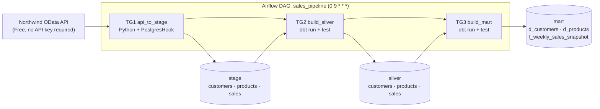

# Sales Pipeline: API → PostgreSQL → dbt (Airflow)

An **idempotent data pipeline** that runs every day at **09:00 (Asia/Baku)**:



## Source API

[Northwind OData V4](https://services.odata.org/V4/Northwind/Northwind.svc/) (free, no registration required, read-only):

| API entity | Stage table | Description |
|---|---|---|
| `Customers` | `stage.customers` | Customer records |
| `Products` (+`$expand=Category`) | `stage.products` | Products, including category names |
| `Orders` (+`$expand=Order_Details`) | `stage.sales` | Each **order line** is represented by one row |

> Northwind is a **static demo dataset** containing orders from 1996–1998. Therefore, the sales API is fully extracted on every run (**full extract**), and duplicates are removed in the silver layer. For a real-world daily data source, we would use `$filter` to retrieve only records within the required date range. The API URL can be configured through `SOURCE_API_BASE_URL` in the `.env` file.

## Getting Started

**Prerequisites:** Docker, Docker Compose, and Python 3 (required only for `init_env.py`).

```bash
python scripts/init_env.py        # Run once: generates .env with randomly generated passwords and displays the admin password
docker compose up --build         # First-time startup may take several minutes while dbt is installed
```

1. Open the Airflow UI at <http://localhost:8080> (login: `admin`; password: the one displayed by `init_env.py`).
2. Unpause the `sales_pipeline` DAG and trigger it manually, or wait for its scheduled execution at 09:00.
3. Connect to the data warehouse using the following connection details:
   - **Host:** `localhost:5433`
   - **Database:** `dwh`
   - **Username:** `dwh_user`
   - **Password:** Defined in `.env`

   You can connect using DBeaver or the VS Code SQL extension.

To start from a clean environment (this permanently deletes all data):

```bash
docker compose down -v
```

## DAG Architecture: Three Task Groups

| Task group | Tasks | Technology |
|---|---|---|
| `api_to_stage` | `load_customers`, `load_products`, `load_sales` (executed in parallel) → `check_stage` (data quality checks) | Python / `PostgresHook` |
| `build_silver` | `dbt_run_silver` → `dbt_test_silver` | dbt |
| `build_mart` | `dbt_run_mart` → `dbt_test_mart` | dbt |

**Execution dependency:**

`api_to_stage >> build_silver >> build_mart`

DAG configuration:

- `schedule="0 9 * * *"`
- `catchup=False`
- `max_active_runs=1`
- Tasks are configured with retries, exponential backoff, and execution timeouts.

### Time Zone Configuration

Airflow operates internally in **UTC**, and this configuration is intentionally left unchanged.

Since the DAG's `start_date` is defined with the `Asia/Baku` timezone, the cron expression `0 9 * * *` corresponds to **09:00 Baku time** (= 05:00 UTC). Azerbaijan does not observe daylight saving time.

The batch date is derived from the `logical_date` according to the **Baku calendar date**, rather than the UTC date. This logic is implemented in `include/sales_pipeline/dates.py` and covered by automated tests.

## Data Layers and Tables

| Schema | Table | Implementation |
|---|---|---|
| `stage` | `customers`, `products`, `sales` | Table definitions are created using `sql/init/`; data is loaded by Airflow. All columns are stored as `TEXT`, alongside `_load_date` and `_loaded_at`. |
| `silver` | `customers`, `products`, `sales` | Built with dbt: trimming whitespace, converting empty strings to `NULL`, type casting, **deduplication**, and amount calculations. |
| `mart` | `d_customers`, `d_products` | Built with dbt as dimension tables. `customer_key` and `product_key` are generated using `md5(natural key)`. |
| `mart` | `f_weekly_sales_snapshot` | Built with dbt. Grain: **week (Monday) × customer × product**. Measures: `total_quantity`, `gross/discount/net_amount`, `order_count`, and `line_count`. |

## Idempotency

Repeated executions for the same batch date do not generate duplicates, and the resulting data remains consistent:

| Layer | Mechanism |
|---|---|
| stage | Within a **single transaction**: `DELETE WHERE _load_date = <batch>` → `INSERT` → validate the row count → `COMMIT`. If an error occurs, the entire transaction is rolled back. The batch date is derived from the run's logical date, not from `now()`. If the API returns an empty dataset, the previously loaded batch is **not deleted**. |
| silver | Uses `table` materialization. For each `(business key)`, only the latest batch is retained using `row_number()`. In the event of a tie, `md5(row)` provides a **deterministic** selection. |
| mart | Uses `table` materialization. The fact table key is composed of `week_start + customer_key + product_key` and is enforced through the `unique_combination` test. |

### Verifying Idempotency

The automated verification script runs the pipeline twice for the same date and compares the results across all layers:

```bash
docker compose up -d
python scripts/verify_idempotency.py --date 2026-10-28
```

Alternatively, idempotency can be verified manually by triggering the DAG twice for the same logical date in Airflow and executing `sql/checks/row_counts.sql` after each run:

```bash
docker compose exec -T dwh-db psql -U dwh_user -d dwh -f - < sql/checks/row_counts.sql
```

The row counts and `SUM(net_amount)` values must remain unchanged between executions.

## Data Quality

The pipeline implements data quality controls at multiple stages:

1. **Extraction:**
   - Schema drift is detected. If a required key field is missing, the pipeline fails.
   - An empty API response causes the pipeline to stop.
   - `nextLink` pagination URLs are accepted only when they belong to the same host.

2. **Loading:**
   - The inserted row count is compared with the expected row count (**reconciliation**).
   - Any mismatch causes the transaction to be rolled back.

3. **`check_stage`:**
   - The batch must not be empty.
   - Key fields must not contain `NULL` or empty values; violations cause the pipeline to fail.
   - Duplicate keys generate warnings.

4. **dbt silver:**
   - `not_null` and `unique` tests.
   - `unique_combination (order_id, product_id)`.
   - `relationships` tests to validate references from sales to customers and products.
   - Business rule validations: `quantity > 0` and `0 ≤ discount ≤ 1`.

5. **dbt mart:**
   - Dimension keys must be unique.
   - Fact table relationships are validated.
   - `week_start` must represent a Monday.
   - **Reconciliation:** `SUM(quantity)` and `SUM(net_amount)` in the fact table must match the corresponding aggregated values in the silver layer.

## Testing and Code Quality

Run the tests inside the container (including Airflow and DAG structure tests):

```bash
docker compose exec airflow-scheduler python -m pytest /opt/airflow/tests -q -p no:cacheprovider
```

Run the tests locally (Python 3.12+):

```bash
pip install -r requirements-dev.txt && pytest -q && ruff check .
```

The test suite covers:

- Batch date calculation and time zone handling.
- OData pagination, retries, and security.
- Data transformation logic.
- **Idempotent loader** behavior using an in-memory mock database.
- Data quality validation rules.
- DAG structure and configuration.

GitHub Actions (`.github/workflows/ci.yml`) automatically runs `ruff` and `pytest`.

## Project Structure

```text
├── docker-compose.yml          # Two PostgreSQL instances + Airflow 3 (LocalExecutor)
├── .env.example                # Environment variable template; actual .env is excluded from Git
├── dags/sales_pipeline_dag.py  # Orchestration logic only
├── include/sales_pipeline/     # Configuration, dates, OData client, transformations, loader, stage_load, quality
├── dbt/                        # Models/{silver,mart}, macros, and generic/singular tests
├── sql/init/                   # Schema and stage table definitions; sql/checks/ - validation queries
├── scripts/                    # init_env.py, verify_idempotency.py
├── tests/                      # Unit tests and DAG tests
└── docker/airflow/             # Dockerfile (dbt installed in a separate virtual environment)
```

## Design Decisions

- **Two separate PostgreSQL instances:** Airflow metadata is isolated from the data warehouse.
- **dbt in a separate virtual environment:** Prevents dependency conflicts between dbt and Airflow.
- **Raw stage layer (`TEXT`):** Source data is preserved without modification; data cleansing and type conversion are performed in the silver layer.
- **No data in XCom:** Tasks return only row counts rather than transferring datasets through XCom.
- **Security:**
  - Secrets are stored exclusively in `.env`, which is excluded from Git.
  - Service ports are bound to `127.0.0.1` only.
  - SQL identifiers are validated, and all data values are passed as query parameters.
  - The dbt `profiles.yml` configuration uses only `env_var` for environment-based settings.

## Known Limitations and Future Improvements

- **No stage-layer retention policy:** A full copy of the source data is stored on every run. In a production environment, an appropriate retention policy should be implemented to remove older batches.
- **Incremental extraction:** An incremental extraction strategy using `$filter` and a date window should be introduced for real-world daily data sources.
- **Additional enhancements:**
  - Implement dbt model contracts and database indexes.
  - Configure `dbt source freshness`.
  - Introduce alerting mechanisms, such as e-mail or Slack callbacks.
  - Create dedicated database roles following the principle of least privilege.