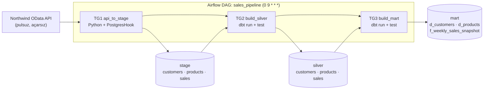

# Sales Pipeline: API → PostgreSQL → dbt (Airflow)

Hər gün səhər **09:00-da (Asia/Baku)** işləyən, **idempotent** data pipeline:



## Mənbə API

[Northwind OData V4](https://services.odata.org/V4/Northwind/Northwind.svc/) (pulsuz, qeydiyyatsız, read-only):

| API entity | Stage cədvəli | Qeyd |
|---|---|---|
| `Customers` | `stage.customers` | müştərilər |
| `Products` (+`$expand=Category`) | `stage.products` | məhsullar, kateqoriya adı ilə |
| `Orders` (+`$expand=Order_Details`) | `stage.sales` | hər **sifariş sətri** = 1 sətir |

> Northwind **statik** demo datadır (sifarişlər 1996–1998). Buna görə satış API-si hər run-da **tam** çəkilir
> (full extract) və dublikatlar silver-də təmizlənir. Real gündəlik mənbədə `$filter` ilə
> yalnız yeni tarixi çəkərdik. URL `.env`-də `SOURCE_API_BASE_URL` ilə dəyişdirilə bilər.

## İşə salmaq

Tələblər: Docker + Docker Compose, Python 3 (yalnız `init_env.py` üçün).

```bash
python scripts/init_env.py        # bir dəfə: .env yaradır (təsadüfi parollar), admin parolunu göstərir
docker compose up --build         # ilk dəfə bir neçə dəqiqə (dbt quraşdırılır)
```

1. Airflow UI: <http://localhost:8080> (login: `admin`, parol: `init_env.py` çıxışında).
2. `sales_pipeline` DAG-ını **unpause** edin və **Trigger** edin (və ya cədvəl üzrə 09:00-ı gözləyin).
3. Warehouse: `localhost:5433`, DB `dwh`, user `dwh_user`, parol `.env`-də (DBeaver / VS Code SQL).

Təmiz başlanğıc (bütün data silinir): `docker compose down -v`

## DAG: 3 task group

| Task group | Tasklar | Alət |
|---|---|---|
| `api_to_stage` | `load_customers`, `load_products`, `load_sales` (paralel) → `check_stage` (DQ) | Python / `PostgresHook` |
| `build_silver` | `dbt_run_silver` → `dbt_test_silver` | dbt |
| `build_mart` | `dbt_run_mart` → `dbt_test_mart` | dbt |

Asılılıq: `api_to_stage >> build_silver >> build_mart`. `schedule="0 9 * * *"`, `catchup=False`,
`max_active_runs=1`, tasklarda retry (exponential backoff) və timeout.

### Vaxt zonası
Airflow daxildə **UTC**-də işləyir (dəyişmirik). DAG-ın `start_date`-i `Asia/Baku` timezone-lu olduğu üçün
`0 9 * * *` **Bakı vaxtı ilə 09:00** (= 05:00 UTC; Azərbaycanda yay/qış saatı yoxdur) deməkdir.
Batch tarixi `logical_date`-in **Bakı təqvimi** üzrə günüdür (`include/sales_pipeline/dates.py`, testlərlə).

## Qatlar və cədvəllər

| Schema | Cədvəl | Necə qurulur |
|---|---|---|
| `stage` | `customers`, `products`, `sales` | `sql/init/` (cədvəllər), Airflow (data). Bütün sütunlar `TEXT` + `_load_date`, `_loaded_at` |
| `silver` | `customers`, `products`, `sales` | dbt: trim, boş→NULL, tip çevirmə, **dublikat silmə**, məbləğ hesablama |
| `mart` | `d_customers`, `d_products` | dbt: dimension-lar, `customer_key` / `product_key` = `md5(natural key)` |
| `mart` | `f_weekly_sales_snapshot` | dbt: grain = **həftə (bazar ertəsi) × müştəri × məhsul**; `total_quantity`, `gross/discount/net_amount`, `order_count`, `line_count` |

## Idempotentlik

Eyni gün üçün təkrar run dublikat yaratmır və nəticə eyni qalır:

| Qat | Mexanizm |
|---|---|
| stage | **Bir transaction-da** `DELETE WHERE _load_date = <batch>` → `INSERT` → sətir sayını yoxla → `COMMIT`. Xəta olarsa tam `ROLLBACK`. Batch tarixi `now()`-dan yox, run-ın logical date-indən gəlir. API boş data qaytarsa, köhnə batch **silinmir** |
| silver | `table` materialization; hər `(business key)` üçün ən yeni batch qalır (`row_number()`), bərabərlikdə `md5(sətir)` ilə **deterministik** seçim |
| mart | `table` materialization; fact açarı `week_start + customer_key + product_key` (`unique_combination` testi ilə qorunur) |

### Yoxlamaq

Avtomatik (DAG-ı eyni tarix üçün 2 dəfə işlədib bütün qatları müqayisə edir):

```bash
docker compose up -d
python scripts/verify_idempotency.py --date 2026-10-28
```

Əl ilə: Airflow-da eyni tarixi iki dəfə trigger edin, hər dəfədən sonra `sql/checks/row_counts.sql` işlədin:

```bash
docker compose exec -T dwh-db psql -U dwh_user -d dwh -f - < sql/checks/row_counts.sql
```

Sətir sayları və `SUM(net_amount)` dəyişməməlidir.

## Data quality

1. **Extract:** schema drift (açar sahə yoxdursa xəta), boş cavab → pipeline dayanır, `nextLink` yalnız eyni host-a.
2. **Load:** insert-dən sonra sətir sayı uyğunlaşdırılır (reconciliation), uyğunsuzluqda rollback.
3. **`check_stage`:** batch boş deyil, açar sahələr NULL/boş deyil (xəta); dublikat açarlar (xəbərdarlıq).
4. **dbt silver:** `not_null`, `unique`, `unique_combination (order_id, product_id)`, `relationships` (sales→customers/products), biznes qaydası (`quantity > 0`, `0 ≤ discount ≤ 1`).
5. **dbt mart:** dimension açarları `unique`, fact `relationships`, `week_start` bazar ertəsidir, və **reconciliation**:
   fact-dakı `SUM(quantity)` və `SUM(net_amount)` silver ilə üst-üstə düşməlidir.

## Testlər və keyfiyyət

```bash
# konteynerin içində (Airflow + DAG strukturu testləri daxil):
docker compose exec airflow-scheduler python -m pytest /opt/airflow/tests -q -p no:cacheprovider

# lokal (Python 3.12+):
pip install -r requirements-dev.txt && pytest -q && ruff check .
```

Testlər: batch tarixi və timezone, OData paging/retry/təhlükəsizlik, transformasiya, **idempotent loader**
(in-memory saxta DB ilə), DQ qaydaları, DAG strukturu. GitHub Actions (`.github/workflows/ci.yml`) `ruff` + `pytest` işlədir.

## Qovluq strukturu

```
├── docker-compose.yml          # 2 Postgres + Airflow 3 (LocalExecutor)
├── .env.example                # şablon; həqiqi .env git-ə getmir
├── dags/sales_pipeline_dag.py  # yalnız orkestrasiya
├── include/sales_pipeline/     # config, dates, odata_client, transform, loader, stage_load, quality
├── dbt/                        # models/{silver,mart}, macros, tests (generic + singular)
├── sql/init/                   # schema + stage cədvəlləri; sql/checks/ - yoxlama sorğuları
├── scripts/                    # init_env.py, verify_idempotency.py
├── tests/                      # unit + DAG testləri
└── docker/airflow/             # Dockerfile (dbt ayrıca virtualenv-də)
```

## Dizayn qərarları

- **İki ayrı Postgres:** Airflow metadata ≠ warehouse.
- **dbt ayrıca virtualenv-də:** dbt və Airflow asılılıq konfliktlərinin qarşısı.
- **Stage = xam (TEXT):** mənbəyə toxunmuruq; təmizləmə silver-dədir.
- **XCom-da data yox:** tasklar yalnız sətir sayı qaytarır.
- **Təhlükəsizlik:** sirlər yalnız `.env`-də (git-ignore), portlar `127.0.0.1`-ə bağlıdır, SQL-də identifier-lər validasiya olunur və dəyərlər həmişə parametrdir, dbt `profiles.yml` yalnız `env_var` istifadə edir.

## Məlum məhdudiyyətlər / növbəti addımlar

- Stage hər run-da tam kopya saxlayır (retention siyasəti yoxdur) - real layihədə köhnə batch-lər təmizlənməlidir.
- Real gündəlik mənbə üçün incremental extract (`$filter` ilə pəncərə) əlavə olunmalıdır.
- dbt `contract`/index-lər, `dbt source freshness`, alerting (e-mail/Slack callback), ayrıca DB rolları (least privilege).
